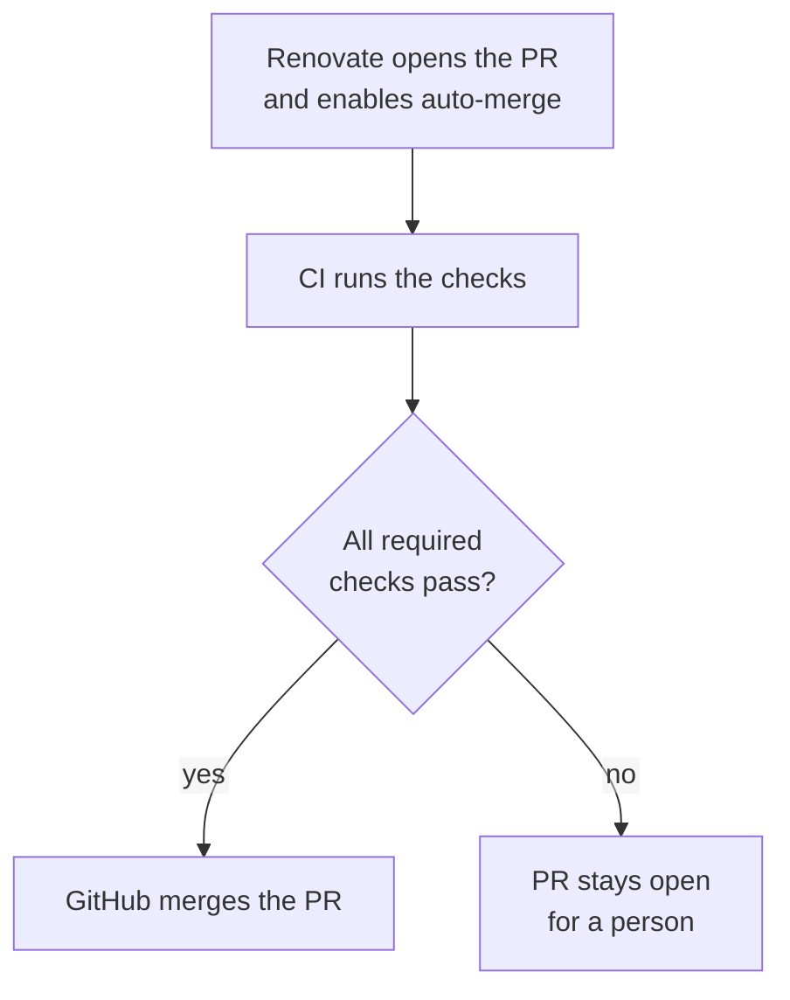

# 03: Automerge

Automerge means that Renovate merges an update without a person, after all status checks (CI) pass. In this example, patch updates merge automatically, and major updates need approval first.

| File | What it shows |
|---|---|
| [`renovate.json5`](renovate.json5) | The configuration, with the automerge defaults written out |
| [`pull-requests/automerge-typescript-patch.md`](pull-requests/automerge-typescript-patch.md) | Patch update that merges automatically |
| [`pull-requests/automerge-blocked-by-failing-check.md`](pull-requests/automerge-blocked-by-failing-check.md) | Patch group that does not merge, because a test fails |
| [`pull-requests/major-after-approval-serilog.md`](pull-requests/major-after-approval-serilog.md) | Major update that waits for approval, then gets a normal PR |

The dependency files are the same as in feature 01: [`package.json`](../01-basic-updates/example-files/package.json) and [`WebApi.csproj`](../01-basic-updates/example-files/WebApi.csproj).

## What happens to each update type

| Update type | Rule | Result |
|---|---|---|
| patch | `automerge: true` | The PR opens and the checks run. If all checks pass, the PR merges |
| minor | No rule | Normal PR. A person merges it |
| major | `dependencyDashboardApproval: true` | No branch and no PR. A checkbox in the Dependency Dashboard. After approval, a normal PR |

## How the CI checks control automerge

Three options decide how the checks control the merge:

| Option | Default | Effect |
|---|---|---|
| `platformAutomerge` | `true` | Renovate turns on GitHub auto-merge. After the required checks pass, GitHub merges. With `false`, Renovate merges in a later run, after it reads the check results itself |
| `ignoreTests` | `false` | Renovate merges only with green checks. A branch without any checks is not green, so it does not merge. With `true`, Renovate merges without checks |
| `automergeType` | `pr` | `pr` merges a PR. `branch` merges the branch directly into `main` without a PR. If a check fails, Renovate opens a PR |

> [!WARNING]
> Set the CI checks as required checks on `main` before you turn on automerge. GitHub auto-merge waits only for required checks. Without required checks, GitHub can merge before the CI finishes.

## Waiting for a new release to settle

Automerge often goes together with `minimumReleaseAge`, for example `minimumReleaseAge: '3 days'`. Renovate then waits three days after the release date before it creates the branch. A release with a serious bug is often unpublished or replaced in that time. This configuration does not use the option, so that the example PRs match the snapshot date 2025-01-17.

## Real behavior and illustration

The lines `🚦 Automerge: Enabled.` and `Disabled by config` and the dashboard checkbox are what Renovate 44 writes. The timelines, the failed test and the PR numbers are fictional.

## Read more

- [Renovate docs: Automerge configuration and troubleshooting](https://docs.renovatebot.com/key-concepts/automerge/)
- [Renovate docs: `platformAutomerge`](https://docs.renovatebot.com/configuration-options/#platformautomerge)
- [Renovate docs: `ignoreTests`](https://docs.renovatebot.com/configuration-options/#ignoretests)
- [Renovate docs: `dependencyDashboardApproval`](https://docs.renovatebot.com/configuration-options/#dependencydashboardapproval)
- [Renovate docs: `minimumReleaseAge`](https://docs.renovatebot.com/configuration-options/#minimumreleaseage)
