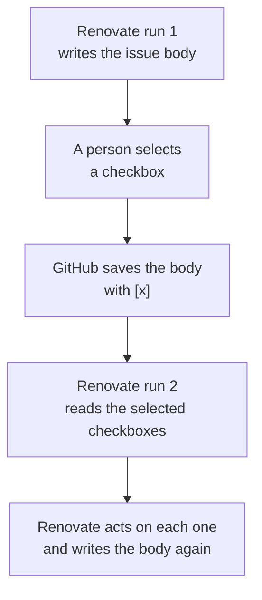

# 04: Dependency Dashboard

The Dependency Dashboard is one GitHub issue per repository. Renovate writes the issue body again in each run. The issue lists every update that Renovate found, also the updates that have no PR. A person selects a checkbox in the issue to tell Renovate what to do in the next run.

| File | What it shows |
|---|---|
| [`renovate.json5`](renovate.json5) | The configuration: the dashboard options, approval for major updates, a group, and lock file maintenance |
| [`dependency-dashboard-issue.md`](dependency-dashboard-issue.md) | The issue for the web application in feature 02 on 2025-01-17, the change after an approval, and the blocked states |

The dependency file is [`package.json`](../02-grouping/example-files/package.json) from feature 02.

## How the checkboxes work

Each checkbox has an HTML comment, for example `<!-- approve-branch=renovate/major-eslint-monorepo -->`. The first word is the action. The text after `branch=` is the branch name. GitHub does not show the comment, but Renovate reads it in the next run. On the Mend Renovate app, an edit of the issue starts a new run. With a self-hosted Renovate, the next run comes at the next scheduled time.

## Sections and states

| Section | The update is... | You can... |
|---|---|---|
| Pending Approval | waiting for a person, because `dependencyDashboardApproval` is `true` | approve it, then Renovate creates the PR |
| Awaiting Schedule | outside its `schedule` | create it now |
| Rate-Limited | over `prConcurrentLimit` or `prHourlyLimit` | create it now |
| Errored | failed in the last run | try again now |
| PR Edited (Blocked) | blocked, because a person pushed a commit to the branch | delete the extra commits and start again |
| Open | a PR that Renovate keeps up to date | rebase it |
| PR Closed (Blocked) | blocked, because a person closed the PR without a merge | open the PR again |
| Deprecations / Replacements | a dependency with a deprecation notice or a replacement rule | read the table. See [feature 06](../06-replacement-prs/README.md) |
| Detected Dependencies | every dependency that Renovate found, per manager and per file | read the list |

A section without items is not in the issue. The issue in this folder shows Pending Approval, Awaiting Schedule, PR Edited (Blocked), Open and Detected Dependencies.

## Pending, approved and blocked

| State | Example in this folder | What changes it |
|---|---|---|
| Pending | `eslint` 9: no branch, a checkbox in "Pending Approval" | A person selects the checkbox |
| Approved | `eslint` 9 after the checkbox: PR #418 in "Open" | Renovate creates the branch and the PR in the next run |
| Blocked | `npm dev tooling` (#415): a developer pushed a commit | A merge, or the checkbox, which deletes the commit |

## Options

| Option | Default | Effect |
|---|---|---|
| `dependencyDashboard.enabled` | `false`, but `true` with `config:recommended` | Renovate creates and updates the issue |
| `dependencyDashboard.title` | `Dependency Dashboard` | The title of the issue. Renovate finds the issue by this title |
| `dependencyDashboard.autoclose` | `false` | If the issue has nothing to show, Renovate closes it |
| `dependencyDashboard.pinned` | `false` | Renovate pins the issue in the GitHub issue list |
| `dependencyDashboard.labels` | not set | Labels for the issue |
| `dependencyDashboard.osvVulnerabilitySummary` | `none` | `all` or `unresolved` adds a section with known vulnerabilities from the OSV database |
| `dependencyDashboardApproval` | `false` | In a package rule: no branch before a person approves |

## Real behavior and illustration

The section titles and texts, the checkbox comments and the sort order come from the Renovate 44 source code. The same is true for the "Detected Dependencies" format. The files are `lib/workers/repository/dependency-dashboard.ts` and `lib/workers/repository/package-files.ts`. The issue number, the PR numbers, the times and the developer actions are fictional.

## Read more

- [Renovate docs: Dependency Dashboard](https://docs.renovatebot.com/key-concepts/dashboard/)
- [Renovate docs: `dependencyDashboard`](https://docs.renovatebot.com/configuration-options/#dependencydashboard)
- [Renovate docs: `dependencyDashboardApproval`](https://docs.renovatebot.com/configuration-options/#dependencydashboardapproval)
