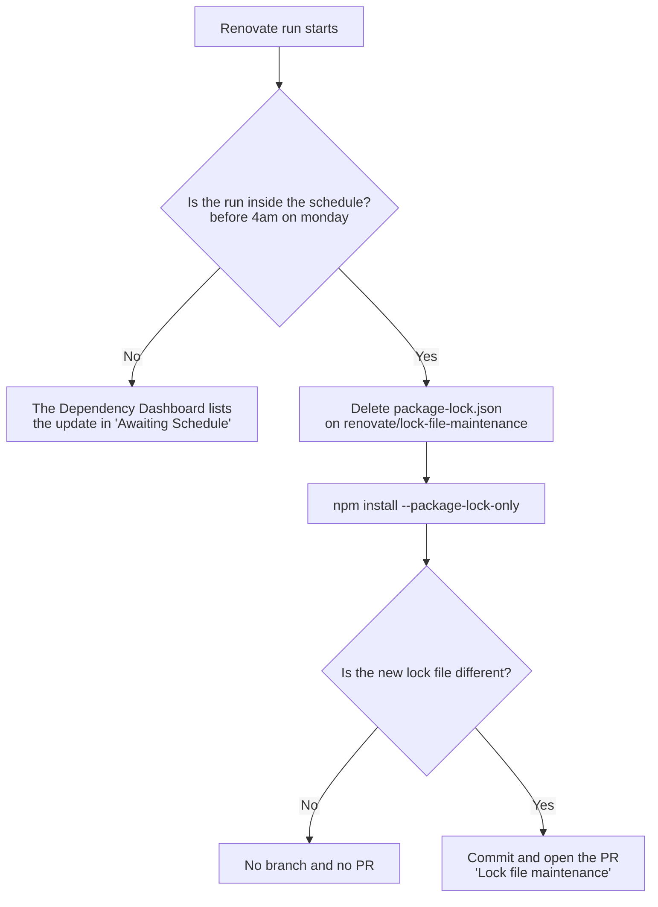

# 05: Lock file maintenance

Lock file maintenance is a Renovate update that creates the lock file again. A lock file, for example `package-lock.json`, records the exact version of every installed package. After the update, each transitive dependency has the newest version that its range allows. A transitive dependency is a dependency of a dependency.

| File | What it shows |
|---|---|
| [`renovate.json5`](renovate.json5) | The configuration: lock file maintenance, enabled, with a weekly schedule |
| [`example-files/before/`](example-files/before/) | `package.json` and `package-lock.json` before the PR |
| [`example-files/after/`](example-files/after/) | The same files after the PR. Only `package-lock.json` changes |
| [`pull-requests/lock-file-maintenance.md`](pull-requests/lock-file-maintenance.md) | The PR "Lock file maintenance" with the diff and the explanation |

## Why transitive dependencies get old

`package.json` names only the direct dependencies. Each package names its own dependencies with a range, for example `^1.15.6`. When npm creates the lock file, it writes the newest version that fits each range on that day.

A normal Renovate update changes a direct dependency in `package.json`. npm then updates only that package in the lock file. If a locked transitive version still fits its range, npm keeps it. Without lock file maintenance, a transitive version can stay the same for years.

| | Normal update | Lock file maintenance |
|---|---|---|
| Changes `package.json` | Yes | No |
| Changes transitive versions | Only the versions that the new direct version needs | Yes, every version that has a newer match |
| PR title | `Update dependency axios to v1.7.9` | `Lock file maintenance` |
| Branch | `renovate/axios-1.x` | `renovate/lock-file-maintenance` |
| Release notes in the PR | Yes, for the direct dependency | No |
| Closed without a merge | Renovate ignores that version | Renovate opens a new PR at the next schedule |
| Enabled by `config:recommended` | Yes | No |

## What Renovate does in each run

The full npm command is `npm install --package-lock-only --no-audit --ignore-scripts`. The flag `--package-lock-only` writes only the lock file and does not download packages to `node_modules`. The [Dependency Dashboard in feature 04](../04-dependency-dashboard/dependency-dashboard-issue.md) shows the update in "Awaiting Schedule" on a Friday.

## Options

| Option | Default | Effect |
|---|---|---|
| `lockFileMaintenance.enabled` | `false` | Renovate creates the lock file maintenance PR |
| `lockFileMaintenance.schedule` | `['before 4am on monday']` | Renovate creates or updates the branch only in this time window |
| `lockFileMaintenance.recreateWhen` | `always` | Renovate opens the PR again after a person closes it without a merge |
| `lockFileMaintenance.automerge` | `false` | Renovate merges the PR after all checks pass. See [feature 03](../03-automerge/README.md) |
| `lockFileMaintenance.commitMessageAction` | `Lock file maintenance` | The PR title and the commit message |
| `lockFileMaintenance.branchTopic` | `lock-file-maintenance` | The last part of the branch name |

Two presets enable lock file maintenance with a schedule:

| Preset | Schedule |
|---|---|
| `:maintainLockFilesWeekly` | `* 0-3 * * 1`: 00:00 to 03:59 on Monday |
| `:maintainLockFilesMonthly` | `* 0-3 1 * *`: 00:00 to 03:59 on the first day of the month |

Many teams add `automerge: true` to `lockFileMaintenance`. With this option, the tests are the review of the new transitive versions. If the tests pass, Renovate merges the PR and no person reads it.

## Lock files in .NET and Helm

Lock file maintenance works for every manager with a lock file that Renovate supports. Examples are npm, pnpm, Yarn, NuGet and Helm:

| Manager | Lock file | Note |
|---|---|---|
| `npm` | `package-lock.json` | Shown in this folder |
| `nuget` | `packages.lock.json` | The project must set `RestorePackagesWithLockFile` to `true` |
| `helmv3` | `Chart.lock` | Records the versions of the chart dependencies. See [feature 09](../09-helm-and-infrastructure/README.md) |

## Real behavior and illustration

These parts come from Renovate 44:

- The PR title, the branch name, the table row and the 🔧 note.
- The 👻 Immortal line and the `"before 4am on monday"` schedule line.
- The npm command. Also the result for a lock file without changes: no branch and no PR.

The source files are `lib/config/options/index.ts`, `lib/workers/repository/update/pr/body/notes.ts` and `lib/modules/manager/npm/post-update/npm.ts`. The two lock files are real. npm 10 created them from the npm registry. The service, the PR number and the times are fictional.

## Read more

- [Renovate docs: `lockFileMaintenance`](https://docs.renovatebot.com/configuration-options/#lockfilemaintenance)
- [Renovate docs: presets `:maintainLockFilesWeekly` and `:maintainLockFilesMonthly`](https://docs.renovatebot.com/presets-default/)
- [npm docs: `package-lock.json`](https://docs.npmjs.com/cli/v10/configuring-npm/package-lock-json)
