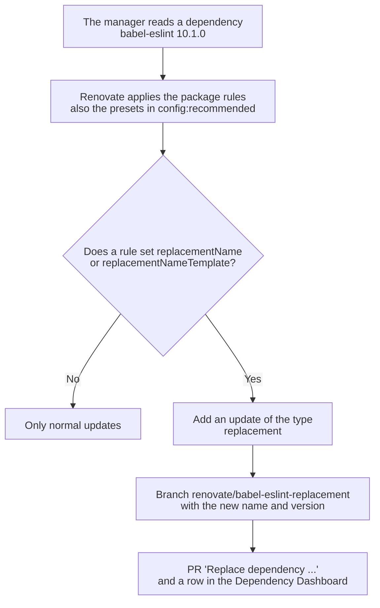

# 06: Replacement PRs

A replacement PR changes the name of a dependency, not only the version. If a package rule gives an old package a new name, Renovate opens one. Typical causes are a renamed package, a package that moved to a new scope, and a deprecated package with a successor.

| File | What it shows |
|---|---|
| [`renovate.json5`](renovate.json5) | The configuration: `config:recommended` with its replacement presets, and an own replacement rule for NuGet |
| [`example-files/`](example-files/) | `package.json` and `.eslintrc.json` of a React application, and three files of a .NET web API, before the PRs |
| [`pull-requests/replace-babel-eslint.md`](pull-requests/replace-babel-eslint.md) | npm: `babel-eslint` to `@babel/eslint-parser`, from a preset |
| [`pull-requests/replace-mvc-versioning.md`](pull-requests/replace-mvc-versioning.md) | NuGet: `Microsoft.AspNetCore.Mvc.Versioning` to `Asp.Versioning.Mvc`, from an own rule |
| [`dependency-dashboard-deprecations.md`](dependency-dashboard-deprecations.md) | The section "Deprecations / Replacements" in the Dependency Dashboard |

## Normal update and replacement

| | Normal update | Replacement |
|---|---|---|
| Changes the package name | No | Yes |
| Update type | patch, minor or major | `replacement` |
| PR title | `Update dependency babel-eslint to v10.1.0` | `Replace dependency babel-eslint with @babel/eslint-parser v7.11.0` |
| Branch | `renovate/babel-eslint-10.x` | `renovate/babel-eslint-replacement` |
| New version | The newest version that the rules allow | `replacementVersion` from the rule, often an old version |
| Release notes in the PR | Yes | No |
| Table columns | Package, Change, Age, Confidence | Package, Type, Update, Change |
| Source of the update | The datasource (the registry) | A package rule. The registry does not name the new package |

## How Renovate finds a replacement



A rule with only `replacementVersion` or `replacementVersionTemplate` also gives a replacement update. Then the name stays the same and only the version changes.

## Presets that `config:recommended` brings

`config:recommended` extends `replacements:all`. That preset extends every replacement preset that the Renovate maintainers keep. Three examples from Renovate 44:

| Preset | Datasource | Old name | New name | New version |
|---|---|---|---|---|
| `replacements:babel-eslint-to-eslint-parser` | npm | `babel-eslint` | `@babel/eslint-parser` | `7.11.0` |
| `replacements:spectre-cli-to-spectre-console-cli` | nuget | `Spectre.Cli` | `Spectre.Console.Cli` | `0.45.0` |
| `replacements:k8s-registry-move` | docker | `k8s.gcr.io/<image>` | `registry.k8s.io/<image>` | Same as before |

The third preset uses a template, not a fixed name. It replaces the registry part of the image name and keeps the rest:

```json
{
  "matchDatasources": ["docker"],
  "matchPackageNames": ["/^k8s\\.gcr\\.io/.+$/"],
  "replacementNameTemplate": "{{{replace 'k8s\\.gcr\\.io/' 'registry.k8s.io/' packageName}}}"
}
```

The image `k8s.gcr.io/ingress-nginx/controller:v1.8.1` becomes `registry.k8s.io/ingress-nginx/controller:v1.8.1`. [Feature 09](../09-helm-and-infrastructure/README.md) shows how Renovate finds images in Kubernetes files.

The full list is in [`lib/data/replacements.json`](https://github.com/renovatebot/renovate/blob/main/lib/data/replacements.json).

## Your own replacement rule

If no preset covers a package, add a package rule. These options are valid only in `packageRules`:

| Option | Effect |
|---|---|
| `replacementName` | The new package name |
| `replacementNameTemplate` | A template for the new name, for example to change the registry part of many image names |
| `replacementVersion` | The new version. Without it, Renovate keeps the current version |
| `replacementVersionTemplate` | A template for the new version |
| `replacementApproach` | npm only. `replace` (default) changes the name. `alias` keeps the old name and writes `npm:<new name>@<version>` |

If the new package has its own version numbers, always set `replacementVersion`. `Asp.Versioning.Mvc` 5.1.0 does not exist, so the rule in this folder sets `8.1.0`.

A rule matches the dependency name and the datasource. Use `matchCurrentVersion` to limit the rule to some versions, as the babel-eslint preset does.

## What Renovate does not change

Renovate changes the dependency files and the lock files. It does not change code or other configuration that uses the old name:

| PR | Renovate changed | A developer changed | The check that found it |
|---|---|---|---|
| `babel-eslint` | `package.json`, `package-lock.json` | `"parser"` in `.eslintrc.json` | lint |
| `Microsoft.AspNetCore.Mvc.Versioning` | `WebApi.csproj` | `using Asp.Versioning;` and `.AddMvc()` in two C# files | build |

For this reason, do not automerge replacement PRs. A green check is the only proof that the code still works with the new package.

## Real behavior and illustration

These parts come from Renovate 44:

- The titles, the branch names, the table columns and the note "This is a special PR that replaces ...".
- The presets and their package rules.
- The Dependency Dashboard section and the badges.

The source files are `lib/config/options/index.ts`, `lib/data/replacements.json`, `lib/workers/repository/process/lookup/utils.ts` and `lib/workers/repository/dependency-dashboard.ts`. The package data, the deprecation messages and the versions come from the npm registry and nuget.org on 2025-01-17. The PR numbers, the build logs and the developer commits are fictional.

## Read more

- [Renovate docs: `replacementName`](https://docs.renovatebot.com/configuration-options/#replacementname)
- [Renovate docs: `replacementNameTemplate`](https://docs.renovatebot.com/configuration-options/#replacementnametemplate)
- [Renovate docs: `replacementApproach`](https://docs.renovatebot.com/configuration-options/#replacementapproach)
- [Renovate docs: replacement presets](https://docs.renovatebot.com/presets-replacements/)
- [ASP.NET API Versioning: migration guide](https://github.com/dotnet/aspnet-api-versioning/wiki/Migration)
