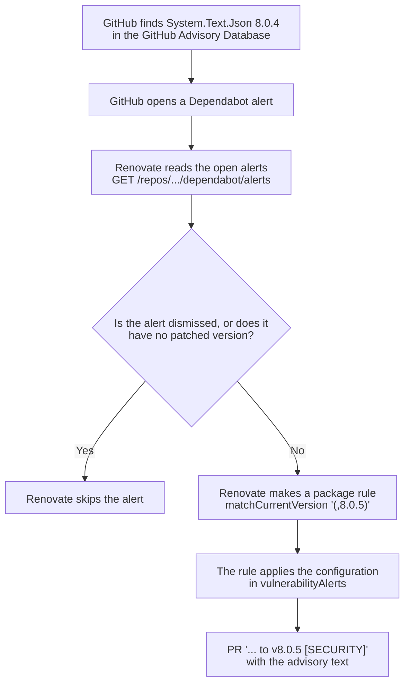

# 07: Vulnerability alerts

A security PR updates a dependency that has a known vulnerability. Renovate opens it from a Dependabot alert on GitHub. The PR ignores the schedule and the PR limits that hold back normal updates.

| File | What it shows |
|---|---|
| [`renovate.json5`](renovate.json5) | The configuration: a weekend schedule for normal updates, and an extra label for security PRs |
| [`example-files/`](example-files/) | `Contoso.Api.Contracts.csproj` and `OrderEvent.cs` of `contoso-api`, before the PR |
| [`pull-requests/security-system-text-json.md`](pull-requests/security-system-text-json.md) | NuGet: `System.Text.Json` 8.0.4 to 8.0.5 for CVE-2024-43485 |

## Normal update and security update

| | Normal update | Security update |
|---|---|---|
| Source of the update | The datasource (the registry) | A Dependabot alert, plus the datasource |
| PR title | `Update dependency System.Text.Json to v8.0.5` | `Update dependency System.Text.Json to v8.0.5 [SECURITY]` |
| Branch | `renovate/system.text.json-8.x` | `renovate/nuget-system.text.json-vulnerability` |
| Schedule | `schedule` from the configuration | At any time |
| `minimumReleaseAge` | Applies | Does not apply |
| PR limits per hour and in total | Apply | Do not apply |
| Group | Follows `groupName` and the group presets | Never in a group |
| New version | The newest version that the rules allow | The lowest version that fixes the vulnerability |
| Advisory text in the PR body | No | Yes |

## How Renovate finds a vulnerability

Renovate does not look for vulnerabilities itself. GitHub compares the dependency graph of the repository with the GitHub Advisory Database. For each match, GitHub opens a Dependabot alert. Renovate reads the open alerts at the start of each run.



Renovate reads these fields from each alert:

| Field in the alert | What Renovate does with it |
|---|---|
| `dismissed_reason` | If a person dismissed the alert, Renovate skips it |
| `security_vulnerability.package.ecosystem` | Selects the datasource. `NUGET` gives `nuget`, `NPM` gives `npm` |
| `security_vulnerability.package.name` | Becomes `matchPackageNames` in the rule |
| `security_vulnerability.first_patched_version.identifier` | Becomes the upper limit in `matchCurrentVersion`. Without it, Renovate skips the alert |
| `security_vulnerability.severity` | Becomes `vulnerabilitySeverity` |
| `security_advisory` | Becomes the advisory text in the PR body: summary, CVE and GHSA links, details, CVSS score and references |

If one package has more than one alert, Renovate makes one rule. The rule uses the highest patched version, and the PR body shows each advisory.

## How Renovate picks the version

`vulnerabilityFixStrategy` decides the new version:

| Value | New version | In the example |
|---|---|---|
| `lowest` (default) | The lowest version that fixes the vulnerability | 8.0.5 |
| `highest` | The newest version that the other rules allow | 9.0.1 |

The default gives the smallest change. A patch update is easier to review and to merge quickly than a major update. After the merge, the normal update to 9.0.1 comes on the next run that the schedule allows.

## Configuration

`vulnerabilityAlerts` is on by default. Renovate applies the object only to security updates. Two other options also control security updates:

| Option | Default | Effect |
|---|---|---|
| `vulnerabilityAlerts` | an object with `enabled: true` | The configuration for security PRs. Your values add to the defaults. Set `enabled: false` to turn security PRs off |
| `vulnerabilityFixStrategy` | `lowest` | The version that a security PR updates to |
| `osvVulnerabilityAlerts` | `false` | Experimental. Renovate also reads the [OSV database](https://osv.dev/) itself. Works on all platforms, not only GitHub |

Use `addLabels` in `vulnerabilityAlerts`, not `labels`. `addLabels` adds to the labels of the repository. `labels` replaces them.

## Requirements

Security PRs from `vulnerabilityAlerts` work on GitHub only. Renovate needs these two things:

1. Dependabot alerts are on in the repository. An admin turns them on in the GitHub page "Code security" of the repository.
2. Renovate can read the alerts. The GitHub App needs the permission "Dependabot alerts: Read-only". The Mend Renovate app has it.

If Renovate cannot read the alerts, it writes this warning in the log and makes no security PRs:

```text
Cannot access vulnerability alerts. Please ensure permissions have been granted.
```

On other platforms, use `osvVulnerabilityAlerts`.

## What Renovate does not do

Renovate does not read the code. In the example, `OrderEvent.cs` uses `[JsonExtensionData]`, so the repository is really affected. A repository without that attribute gets the same PR.

Renovate does not update the runtime on the hosts. CVE-2024-43485 also affects .NET 8.0.8 and earlier. If the app runs on a shared .NET runtime, update the base image or the hosts too.

Renovate does not fix a vulnerability that has no patched version. GitHub shows the alert, and Renovate skips it.

## Real behavior and illustration

These parts come from Renovate 44:

- The title, the branch name, the labels and the table in the PR.
- The format of the advisory text, made with the Renovate function that writes it.
- The release notes, made with the Renovate functions that change and link them.
- The defaults of `vulnerabilityAlerts`.

The source files are `lib/config/options/index.ts`, `lib/workers/repository/init/vulnerability.ts`, `lib/workers/repository/process/lookup/vulnerability.ts` and `lib/modules/platform/github/index.ts`. The advisory GHSA-8g4q-xg66-9fp4 and the release v8.0.5 of dotnet/runtime come from GitHub. The versions come from nuget.org on 2025-01-17. The repository, the PR number and the check results are fictional.

## Read more

- [Renovate docs: `vulnerabilityAlerts`](https://docs.renovatebot.com/configuration-options/#vulnerabilityalerts)
- [Renovate docs: `vulnerabilityFixStrategy`](https://docs.renovatebot.com/configuration-options/#vulnerabilityfixstrategy)
- [Renovate docs: `osvVulnerabilityAlerts`](https://docs.renovatebot.com/configuration-options/#osvvulnerabilityalerts)
- [Renovate docs: security and permissions](https://docs.renovatebot.com/security-and-permissions/)
- [GitHub Advisory: GHSA-8g4q-xg66-9fp4](https://github.com/advisories/GHSA-8g4q-xg66-9fp4)
