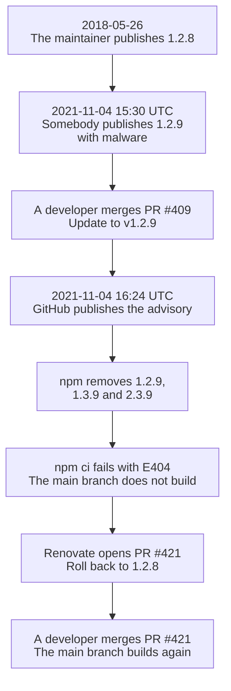
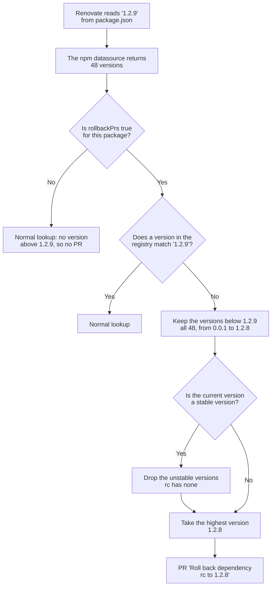

# 08: Rollback PRs

A rollback PR moves a dependency to a lower version. If the version in the repository no longer exists in the registry, Renovate opens a rollback PR. The option `rollbackPrs` is off by default.

| File | What it shows |
|---|---|
| [`renovate.json5`](renovate.json5) | The configuration: `rollbackPrs` for the npm package `rc` only, and a `rollback` label |
| [`example-files/`](example-files/) | `package.json` of an Angular app that pins `rc` 1.2.9, before the PR |
| [`pull-requests/rollback-rc.md`](pull-requests/rollback-rc.md) | npm: `rc` 1.2.9 to 1.2.8, after npm removed 1.2.9 |

## The scenario

The npm package `rc` reads configuration files for Node.js tools. On 2021-11-04, somebody published three versions of `rc` with malware: 1.2.9, 1.3.9 and 2.3.9. GitHub published the advisory [GHSA-g2q5-5433-rhrf](https://github.com/advisories/GHSA-g2q5-5433-rhrf), and npm removed the three versions. The example repository updated to 1.2.9 before the removal.



The registry before and after the removal:

| Version | 2021-11-04, 15:31 UTC | After the removal |
|---|---|---|
| 0.0.1 to 1.2.7 | Yes, 47 versions | Yes |
| 1.2.8 | Yes | Yes |
| 1.2.9 | Yes | ~~1.2.9~~ removed |
| 1.3.9 | Yes | ~~1.3.9~~ removed |
| 2.3.9 | Yes | ~~2.3.9~~ removed |

The registry still lists the publish times of the three removed versions in the `time` field of the package document. The versions themselves are gone.

## How Renovate picks the version



Renovate does not pick the version before the last update. It picks the highest version below the missing version. In the example, both are 1.2.8. The advisory also names 1.2.8 as the version to go back to.

The PR updates `package.json`. In a repository with `package-lock.json`, Renovate also runs `npm install` to update the lock file. The PR body has no release notes, because Renovate shows release notes only for versions above the current version.

## Configuration

| Option | Default | Effect |
|---|---|---|
| `rollbackPrs` | `false` | If no version in the registry matches the current value, Renovate makes a rollback update |
| `rollback` | see below | The configuration that Renovate applies only to rollback updates. Your values add to the defaults |

The defaults of `rollback` in Renovate 44:

| Field | Default | Result in the example |
|---|---|---|
| `branchTopic` | `{{{depNameSanitized}}}-rollback` | `renovate/rc-rollback` |
| `commitMessageAction` | `Roll back` | `Roll back dependency rc to 1.2.8` |
| `semanticCommitType` | `fix` | With semantic commits on: `fix(deps): roll back ...` |

The Renovate docs recommend that you turn on `rollbackPrs` in `packageRules` for some packages, not for all packages. A good match is a package from your own registry, where a person can delete a version. The docs also say that you must not use `rollbackPrs` together with `constraintsFiltering: 'strict'`.

If the package is in a private registry, Renovate must have read access to it. For GitHub Packages, the Renovate installation needs a token with `read:packages` in `hostRules` for `npm.pkg.github.com`.

## When Renovate opens no rollback PR

A rollback PR needs a missing version. Renovate opens no PR in these cases:

1. The broken version is still in the registry. Renovate sees a valid version and has nothing to do.
2. `rollbackPrs` is `false` for the package. Renovate finds no version above 1.2.9 and opens no PR.
3. No version below the current version exists. Renovate writes the warning `Can't find version matching 1.2.9 for npm package rc` in the log and on the Dependency Dashboard.

On npmjs.org, a package owner can unpublish a version only under strict conditions. npm itself removes a version with malware, as with `rc` 1.2.9. A deleted version is more frequent in a private registry.

If a broken version stays in the registry, revert the update with git. Then stop Renovate from proposing that version again:

```json5
{
  packageRules: [
    {
      matchPackageNames: ['rc'],
      allowedVersions: '!/^1\\.2\\.9$/',
    },
  ],
}
```

## Three kinds of rollback

The word "rollback" means different things in different tools:

| | Renovate rollback PR | Revert in git | Deployment rollback |
|---|---|---|---|
| Example | PR #421 | `git revert` of the merge of PR #409 | `kubectl rollout undo`, `helm rollback` |
| What changes | One dependency in `package.json` and `package-lock.json` | Every file in the reverted commit | The release that runs in the cluster |
| Trigger | The version is missing from the registry | A person, after a failed build or a bug | A person or a tool, after a failed deploy or health check |
| Target version | The highest version below the missing version | The state before the reverted commit | The release before the current release |
| Fixes the build | Yes | Yes | No. The repository still pins 1.2.9 |
| Broken version still in the registry | No PR | Works | Works |

A deployment rollback changes only the cluster. With GitOps tools such as Flux, the next sync applies the repository again. Then a revert in git is the rollback.

## Real behavior and illustration

These parts come from Renovate 44:

- The option `rollbackPrs`, its default and the `rollback` defaults.
- The rules that pick the version.
- The title, the branch name and the table in the PR.
- The note in the PR body, word for word.

The source files are `lib/config/options/index.ts`, `lib/workers/repository/process/lookup/index.ts` and `lib/workers/repository/process/lookup/rollback.ts`.

The package `rc`, its 48 versions, the publish times, the advisory and the removal are real. The npm error came from npm 11.17.0 on 2026-11-21. The PR numbers #409 and #421 are fictional. The other dependencies in `example-files/package.json` have versions from 2024 and 2025, not from 2021.

Renovate runs on this repository with the same rule for `rc`, so it opens a real rollback PR for [`example-files/package.json`](example-files/package.json).

## Read more

- [Renovate docs: `rollbackPrs`](https://docs.renovatebot.com/configuration-options/#rollbackprs)
- [Renovate docs: `rollback`](https://docs.renovatebot.com/configuration-options/#rollback)
- [Renovate docs: `allowedVersions`](https://docs.renovatebot.com/configuration-options/#allowedversions)
- [npm docs: unpublish policy](https://docs.npmjs.com/policies/unpublish)
- [GitHub advisory GHSA-g2q5-5433-rhrf: Embedded malware in rc](https://github.com/advisories/GHSA-g2q5-5433-rhrf)
