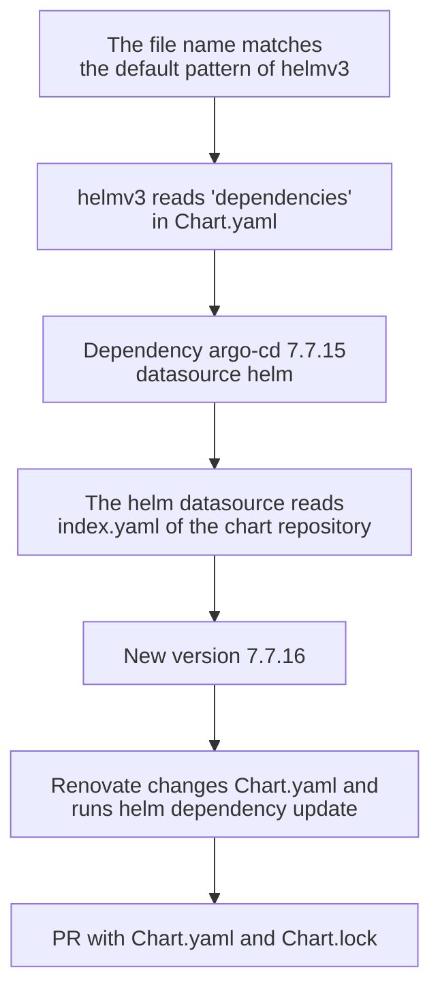

# 09.1: Helm chart dependencies

A Helm chart can depend on other charts. The list of these charts is under `dependencies` in `Chart.yaml`. The built-in manager `helmv3` reads the list and updates each chart version. The example is the chart `argocd`, which wraps the public chart `argo-cd` from the Argo project.

| File | What it shows |
|---|---|
| [`renovate.json5`](renovate.json5) | The configuration: `config:recommended` and a label for Helm updates |
| [`example-files/Chart.yaml`](example-files/Chart.yaml) | `Chart.yaml` of the chart `argocd`, before the PR |
| [`example-files/Chart.lock`](example-files/Chart.lock) | `Chart.lock` of the chart `argocd`, before the PR |
| [`pull-requests/helm-argo-cd.md`](pull-requests/helm-argo-cd.md) | PR #73: `argo-cd` 7.7.15 to 7.7.16 |

## How Renovate finds the dependency



The default file pattern of `helmv3` is `/(^|/)Chart\.ya?ml$/`. So Renovate finds every `Chart.yaml` and `Chart.yml` in the repository without configuration.

Each item in `dependencies` gives one dependency:

| Field in Chart.yaml | Field in Renovate | Value in the example |
|---|---|---|
| `name` | `depName` | `argo-cd` |
| `version` | `currentValue` | `7.7.15` |
| `repository` | `registryUrls` | `https://argoproj.github.io/argo-helm` |

If `repository` starts with `https://`, the datasource is `helm`. The datasource downloads `index.yaml` from the repository and reads the versions of the chart. If `repository` starts with `oci://`, the datasource is `docker`. [Part 2](../02-helm-oci-chart/README.md) shows that case.

## The lock file

`Chart.lock` holds the resolved versions and a digest of the dependencies. If `Chart.lock` is in the repository, Renovate updates it with these commands:

```sh
helm repo add argo-cd https://argoproj.github.io/argo-helm --force-update
helm dependency update features/09-helm-and-infrastructure/01-helm-chart-dependencies/example-files
```

The Renovate installation must have Helm, or it must install Helm. The Mend Renovate app and the `ghcr.io/renovatebot/renovate` image do this. If Helm is missing and you run Renovate yourself, set `binarySource` to `install`.

`helm dependency update` also downloads the chart archives to the `charts/` folder. If `postUpdateOptions` contains `helmUpdateSubChartArchives`, Renovate commits the archives too. Without it, Renovate commits only `Chart.yaml` and `Chart.lock`.

## The version of the chart itself

The version `0.14.0` of `argocd` stays the same in the PR. If a chart repository requires a new chart version for each change, add `bumpVersion: 'patch'` to the package rule. Then Renovate also changes `version` in `Chart.yaml`, for example to `0.14.1`. The comment at the end of [`renovate.json5`](renovate.json5) shows where.

## Real behavior and illustration

These parts come from Renovate 44 and the argo-helm repository:

- The default file pattern, the extracted fields, the datasource and the Helm commands.
- The PR title, the branch name, the table and the release notes.
- The versions and the release dates of the `argo-cd` chart.

The source files are `lib/modules/manager/helmv3/extract.ts`, `lib/modules/manager/helmv3/artifacts.ts` and `lib/modules/datasource/helm/index.ts`. The digests in `Chart.lock` are the real values that Helm calculates for 7.7.15 and 7.7.16. The PR number #73, the `generated` times in `Chart.lock` and the checks are fictional.

The example PR is from 2025-01-17. Renovate runs on this repository every hour, so it opens a real PR for [`example-files/Chart.yaml`](example-files/Chart.yaml) to the newest version of `argo-cd`.

## Read more

- [Renovate docs: helmv3 manager](https://docs.renovatebot.com/modules/manager/helmv3/)
- [Renovate docs: helm datasource](https://docs.renovatebot.com/modules/datasource/helm/)
- [Renovate docs: `bumpVersion`](https://docs.renovatebot.com/configuration-options/#bumpversion)
- [Renovate docs: `postUpdateOptions`](https://docs.renovatebot.com/configuration-options/#postupdateoptions)
- [Helm docs: chart dependencies](https://helm.sh/docs/helm/helm_dependency/)
