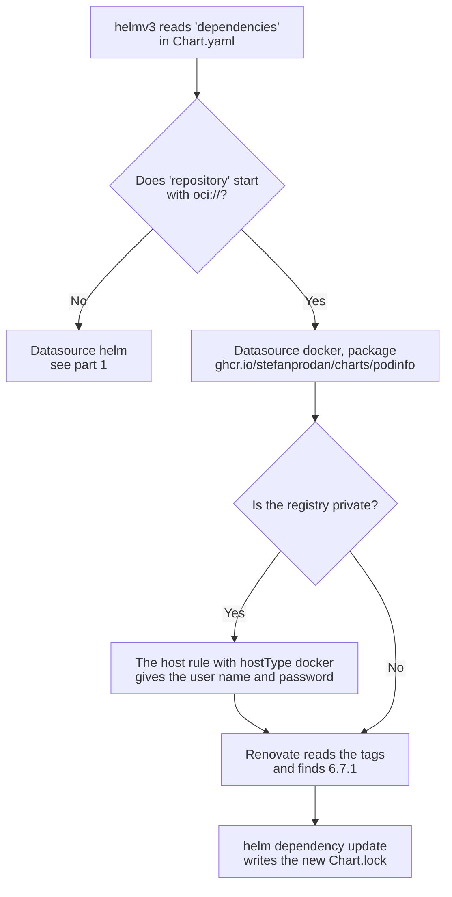

# 09.2: A Helm chart in an OCI registry

Many Helm charts are in a container registry, for example GitHub Container Registry (ghcr.io). Such a registry is an OCI registry (a registry for container images and other artifacts). `Chart.yaml` then names the chart repository with `oci://`. The same `helmv3` manager as in [part 1](../01-helm-chart-dependencies/README.md) finds the dependency, but Renovate uses another datasource.

The example uses the public chart [podinfo](https://github.com/stefanprodan/podinfo). Its maintainer publishes the chart to `oci://ghcr.io/stefanprodan/charts`.

| File | What it shows |
|---|---|
| [`renovate.json5`](renovate.json5) | The configuration: no host rule, because the registry is public |
| [`example-files/Chart.yaml`](example-files/Chart.yaml) | The chart `demo-app` with `podinfo` 6.6.3 as a dependency, before the PR |
| [`example-files/Chart.lock`](example-files/Chart.lock) | The lock file of `demo-app`, before the PR |
| [`pull-requests/helm-podinfo.md`](pull-requests/helm-podinfo.md) | PR #74: `podinfo` 6.6.3 to 6.7.1 |

## HTTPS repository and OCI registry

| | HTTPS chart repository (part 1) | OCI registry (this part) |
|---|---|---|
| `repository` in Chart.yaml | `https://argoproj.github.io/argo-helm` | `oci://ghcr.io/stefanprodan/charts` |
| Datasource | `helm` | `docker` |
| Where Renovate reads the versions | `index.yaml` of the repository | The tags of `ghcr.io/stefanprodan/charts/podinfo` |
| `hostType` of a host rule | `helm` | `docker` |
| Commit message topic | `Helm release argo-cd` | `podinfo Docker tag` |
| Helm command before the lock file update, for a private registry | `helm repo add` | `helm registry login` |

## How Renovate finds the dependency



## A host rule for a private registry

The chart `podinfo` is public, so this example needs no host rule. If your charts are in a private repository on ghcr.io, Renovate needs read access:

```json5
hostRules: [
  {
    hostType: 'docker',
    matchHost: 'ghcr.io',
    username: 'renovate-bot',
    password: '{{ secrets.GHCR_TOKEN }}',
  },
],
```

Renovate uses this one host rule for two steps. The `docker` datasource reads the tags with it. Before `helm dependency update`, Renovate gives the same user name and password to `helm registry login`.

The value `{{ secrets.GHCR_TOKEN }}` is a reference to a secret. The real token is in the configuration of the Renovate installation, not in the repository. For ghcr.io, use a token with the scope `read:packages` only.

If the host rule has `hostType: 'helm'`, the `docker` datasource does not use it. Then Renovate cannot read the tags. The Dependency Dashboard shows the warning "Renovate failed to look up the following dependencies".

If the same registry also has container images, the host rule covers them too. [Part 3](../03-helm-values-images/README.md) updates the image of podinfo from the same registry.

## Release notes from the chart

Renovate looks for the source repository of the chart in this order:

1. The annotation `org.opencontainers.image.source` in the manifest of the chart.
2. The field `home` in the configuration blob of the chart. The blob holds the fields of `Chart.yaml`. The repository name in `home` must contain `chart` or `helm`.
3. The first URL in `sources` whose repository name contains `chart` or `helm`.
4. The first URL in `sources`.

Renovate links the package name to that URL and reads the release notes from it. The chart podinfo has no annotation. It has `https://github.com/stefanprodan/podinfo` in `home` and in `sources`. The name `podinfo` contains neither word, so the URL comes from step 4.

A chart without the annotation and without `sources` gets no link and no release notes. For your own charts, add `sources` with the URL of the repository.

## Real behavior and illustration

These parts come from Renovate 44:

- The datasource choice for `oci://`, the package name and the host type.
- The Helm commands, the PR title, the branch name and the table.
- The order in which Renovate looks for the source repository, and the link and the release notes from it.

The source files are `lib/modules/manager/helmv3/extract.ts`, `lib/modules/manager/helmv3/utils.ts`, `lib/modules/manager/helmv3/artifacts.ts` and `lib/modules/datasource/docker/index.ts`.

The chart podinfo, its versions, its release notes and the digests in Chart.lock are real. A lookup with Renovate 44.247.1 on 2026-11-21 found the package name `ghcr.io/stefanprodan/charts/podinfo` and the source URL `https://github.com/stefanprodan/podinfo`. The PR number #74 and the `generated` times in Chart.lock are fictional.

The example PR is from 2025-01-17. On that day, 6.7.1 was the newest version. Renovate runs on this repository once a day, so it opens a real PR for [`example-files/Chart.yaml`](example-files/Chart.yaml). On 2026-11-21, that PR goes to 6.17.0.

## Read more

- [Renovate docs: helmv3 manager](https://docs.renovatebot.com/modules/manager/helmv3/)
- [Renovate docs: docker datasource](https://docs.renovatebot.com/modules/datasource/docker/)
- [Renovate docs: private registries with Docker](https://docs.renovatebot.com/docker/#private-registries)
- [Helm docs: use OCI-based registries](https://helm.sh/docs/topics/registries/)
- [podinfo on GitHub](https://github.com/stefanprodan/podinfo)
