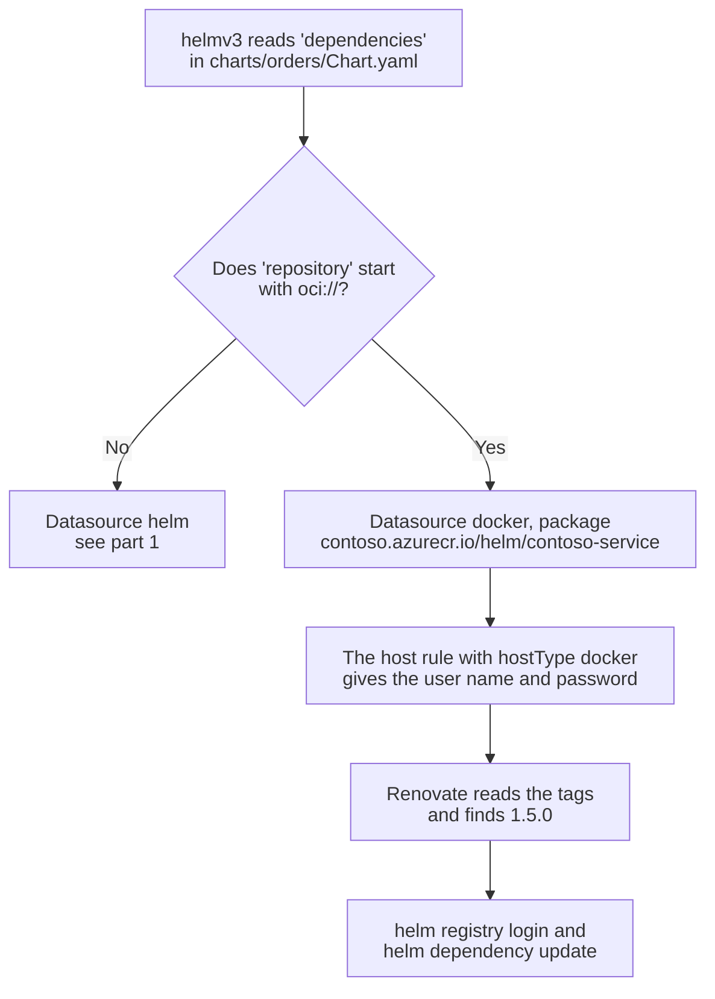

# 09.2: An internal Helm chart in an OCI registry

Many companies keep their own Helm charts in a container registry, for example Azure Container Registry. Such a registry is an OCI registry (a registry for container images and other artifacts). `Chart.yaml` then names the chart repository with `oci://`. The same `helmv3` manager as in [part 1](../01-helm-chart-dependencies/README.md) finds the dependency, but Renovate uses another datasource.

| File | What it shows |
|---|---|
| [`renovate.json5`](renovate.json5) | The configuration: a host rule with read access to `contoso.azurecr.io` |
| [`example-files/Chart.yaml`](example-files/Chart.yaml) | `charts/orders/Chart.yaml` before the PR |
| [`example-files/Chart.lock`](example-files/Chart.lock) | `charts/orders/Chart.lock` before the PR |
| [`pull-requests/helm-contoso-service.md`](pull-requests/helm-contoso-service.md) | PR #74: `contoso-service` 1.4.2 to 1.5.0 |

## HTTPS repository and OCI registry

| | HTTPS chart repository (part 1) | OCI registry (this part) |
|---|---|---|
| `repository` in Chart.yaml | `https://argoproj.github.io/argo-helm` | `oci://contoso.azurecr.io/helm` |
| Datasource | `helm` | `docker` |
| Where Renovate reads the versions | `index.yaml` of the repository | The tags of `contoso.azurecr.io/helm/contoso-service` |
| `hostType` of the host rule | `helm` | `docker` |
| Commit message topic | `Helm release argo-cd` | `contoso-service Docker tag` |
| Helm command before the lock file update | `helm repo add` | `helm registry login` |

## How Renovate finds the dependency



## The host rule

```json5
hostRules: [
  {
    hostType: 'docker',
    matchHost: 'contoso.azurecr.io',
    username: 'renovate-pull',
    password: '{{ secrets.ACR_PASSWORD }}',
  },
],
```

Renovate uses this one host rule for two steps. The `docker` datasource reads the tags with it. Before `helm dependency update`, Renovate gives the same user name and password to `helm registry login`.

The value `{{ secrets.ACR_PASSWORD }}` is a reference to a secret. The real password is in the configuration of the Renovate installation, not in the repository. In Azure Container Registry, use a token for one repository with read access only.

If the same registry also has container images, the host rule covers them too. [Part 3](../03-helm-values-images/README.md) uses the same host rule for the image `orders-api`.

## Real behavior and illustration

These parts come from Renovate 44:

- The datasource choice for `oci://`, the package name and the host type.
- The Helm commands, the PR title, the branch name and the table.
- For a chart without `home` and `sources`, the package name without a link and the PR without release notes.

The source files are `lib/modules/manager/helmv3/extract.ts`, `lib/modules/manager/helmv3/utils.ts`, `lib/modules/manager/helmv3/artifacts.ts` and `lib/modules/datasource/docker/index.ts`. The chart `contoso-service`, the registry, the repository and the digests are fictional.

## Read more

- [Renovate docs: helmv3 manager](https://docs.renovatebot.com/modules/manager/helmv3/)
- [Renovate docs: docker datasource](https://docs.renovatebot.com/modules/datasource/docker/)
- [Renovate docs: private registries with Docker](https://docs.renovatebot.com/docker/#private-registries)
- [Helm docs: use OCI-based registries](https://helm.sh/docs/topics/registries/)
