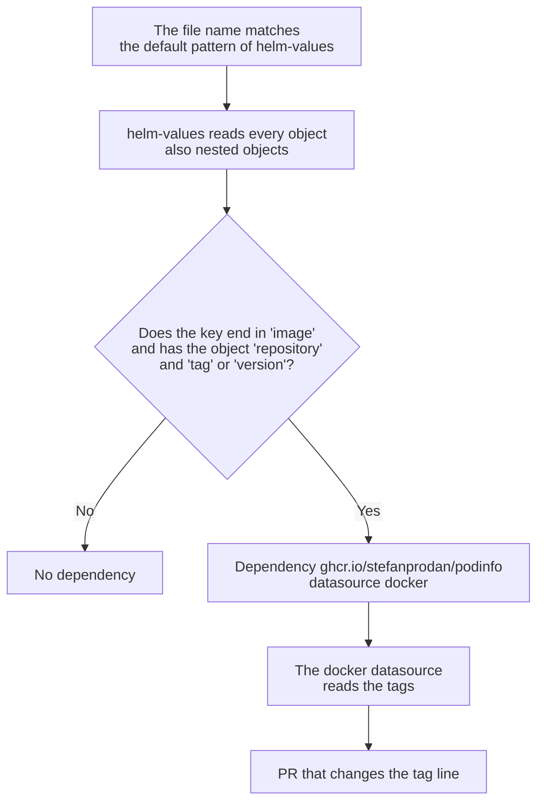

# 09.3: Container images in values.yaml

A Helm chart usually takes the container image from `values.yaml`. The built-in manager `helm-values` reads that file and updates the image tags. The example is the `values.yaml` of the chart `demo-app` from [part 2](../02-helm-oci-chart/README.md). It sets the public image `ghcr.io/stefanprodan/podinfo` for the subchart `podinfo`.

| File | What it shows |
|---|---|
| [`renovate.json5`](renovate.json5) | The configuration: an optional file pattern for more values files |
| [`example-files/values.yaml`](example-files/values.yaml) | The `values.yaml` of `demo-app`, before the PR |
| [`pull-requests/image-podinfo.md`](pull-requests/image-podinfo.md) | PR #75: `ghcr.io/stefanprodan/podinfo` 6.7.0 to 6.7.1 |

## How Renovate finds the image

The default file pattern of `helm-values` is `/(^|/)values\.ya?ml$/`. It finds `values.yaml` and `values.yml` in every folder.

## The shape that Renovate reads

The key of the object must end in `image`, with any case. So `image`, `initImage` and `sidecarImage` all work. The object must have these fields:

| Field | Required | Value in the example |
|---|---|---|
| `repository` | Yes | `ghcr.io/stefanprodan/podinfo` |
| `tag` or `version` | Yes | `6.7.0` |
| `registry` | No | not set |

If the object has `registry`, Renovate joins `registry` and `repository` to the image name. For example, `registry: ghcr.io` and `repository: stefanprodan/podinfo` give the same name as the example. Without `registry` and without a host in `repository`, the image comes from Docker Hub.

The manager also reads two other shapes, and it skips the rest:

| Shape in values.yaml | Result |
|---|---|
| `image: ghcr.io/stefanprodan/podinfo:6.7.0` | A dependency. The string is a full image reference |
| `image: ghcr.io/stefanprodan/podinfo` with `tag: 6.7.0` beside it | A dependency. The version comes from the key `tag` or `version` beside it |
| `image: { name: ghcr.io/stefanprodan/podinfo, tag: 6.7.0 }` | No dependency. The object has no `repository` |
| `app: { repository: ghcr.io/stefanprodan/podinfo, tag: 6.7.0 }` | No dependency. The key does not end in `image` |

For these shapes, use a custom regex manager. [Part 4](../04-custom-regex-manager/README.md) shows how.

## A private registry

The image podinfo is public, so this example needs no host rule. For an image in a private registry, Renovate needs a host rule with `hostType: 'docker'`. [Part 2](../02-helm-oci-chart/README.md) shows a host rule for ghcr.io. If your charts and your images are in the same registry, that one host rule covers both.

## More values files

Charts often have one values file for each environment, for example `values-production.yaml`. These files do not match the default pattern. The end of [`renovate.json5`](renovate.json5) has a commented-out pattern that also finds them. If you set `managerFilePatterns`, Renovate adds your patterns to the default pattern.

## Real behavior and illustration

These parts come from Renovate 44:

- The default file pattern, the key rule and the fields of the object.
- The image name, the datasource and the changed line.
- The PR title, the branch name, the table, and the link and the release notes from the image label `org.opencontainers.image.source`.

The source files are `lib/modules/manager/helm-values/extract.ts` and `lib/modules/manager/helm-values/util.ts`.

The image podinfo, its versions, its label and its release notes are real. A lookup with Renovate 44.247.1 on 2026-11-21 found the branch name `renovate/ghcr.io-stefanprodan-podinfo-6.x` and the source URL `https://github.com/stefanprodan/podinfo`. The PR number #75 is fictional.

The example PR is from 2025-01-17. On that day, 6.7.1 was the newest version. Renovate runs on this repository every hour, so it opens a real PR for [`example-files/values.yaml`](example-files/values.yaml). On 2026-11-21, that PR goes to 6.17.0.

## Read more

- [Renovate docs: helm-values manager](https://docs.renovatebot.com/modules/manager/helm-values/)
- [Renovate docs: `managerFilePatterns`](https://docs.renovatebot.com/configuration-options/#managerfilepatterns)
- [Renovate docs: docker datasource](https://docs.renovatebot.com/modules/datasource/docker/)
