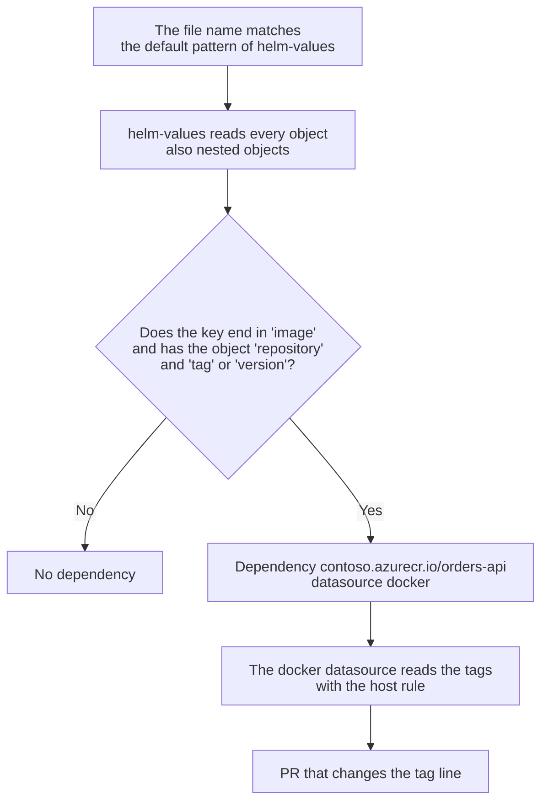

# 09.3: Container images in values.yaml

A Helm chart usually takes the container image from `values.yaml`. The built-in manager `helm-values` reads that file and updates the image tags. The example is `charts/orders/values.yaml`. It sets the image `orders-api` from the private registry `contoso.azurecr.io` for the subchart `contoso-service` from [part 2](../02-helm-oci-internal-chart/README.md).

| File | What it shows |
|---|---|
| [`renovate.json5`](renovate.json5) | The configuration: a host rule for the registry, and an optional file pattern for more values files |
| [`example-files/values.yaml`](example-files/values.yaml) | `charts/orders/values.yaml` before the PR |
| [`pull-requests/image-orders-api.md`](pull-requests/image-orders-api.md) | PR #75: `contoso.azurecr.io/orders-api` 1.7.2 to 1.8.0 |

## How Renovate finds the image

The default file pattern of `helm-values` is `/(^|/)values\.ya?ml$/`. It finds `values.yaml` and `values.yml` in every folder.

## The shape that Renovate reads

The key of the object must end in `image`, with any case. So `image`, `initImage` and `sidecarImage` all work. The object must have these fields:

| Field | Required | Value in the example |
|---|---|---|
| `repository` | Yes | `orders-api` |
| `tag` or `version` | Yes | `1.7.2` |
| `registry` | No | `contoso.azurecr.io` |

Renovate joins `registry` and `repository` to the image name `contoso.azurecr.io/orders-api`. Without `registry`, the name is only `repository`, and the image comes from Docker Hub.

The manager also reads two other shapes, and it skips the rest:

| Shape in values.yaml | Result |
|---|---|
| `image: contoso.azurecr.io/orders-api:1.7.2` | A dependency. The string is a full image reference |
| `image: orders-api` with `tag: 1.7.2` beside it | A dependency. The version comes from the key `tag` or `version` beside it |
| `image: { name: orders-api, tag: 1.7.2 }` | No dependency. The object has no `repository` |
| `api: { repository: orders-api, tag: 1.7.2 }` | No dependency. The key does not end in `image` |

For these shapes, use a custom regex manager. [Part 4](../04-custom-regex-manager/README.md) shows how.

## More values files

Charts often have one values file for each environment, for example `values-production.yaml`. These files do not match the default pattern. The end of [`renovate.json5`](renovate.json5) has a commented-out pattern that also finds them. If you set `managerFilePatterns`, Renovate adds your patterns to the default pattern.

## Real behavior and illustration

These parts come from Renovate 44:

- The default file pattern, the key rule and the fields of the object.
- The image name with the registry, the datasource and the changed line.
- The PR title, the branch name, the table, and the PR without release notes.

The source files are `lib/modules/manager/helm-values/extract.ts` and `lib/modules/manager/helm-values/util.ts`. The image, the registry and the repository are fictional.

## Read more

- [Renovate docs: helm-values manager](https://docs.renovatebot.com/modules/manager/helm-values/)
- [Renovate docs: `managerFilePatterns`](https://docs.renovatebot.com/configuration-options/#managerfilepatterns)
- [Renovate docs: docker datasource](https://docs.renovatebot.com/modules/datasource/docker/)
