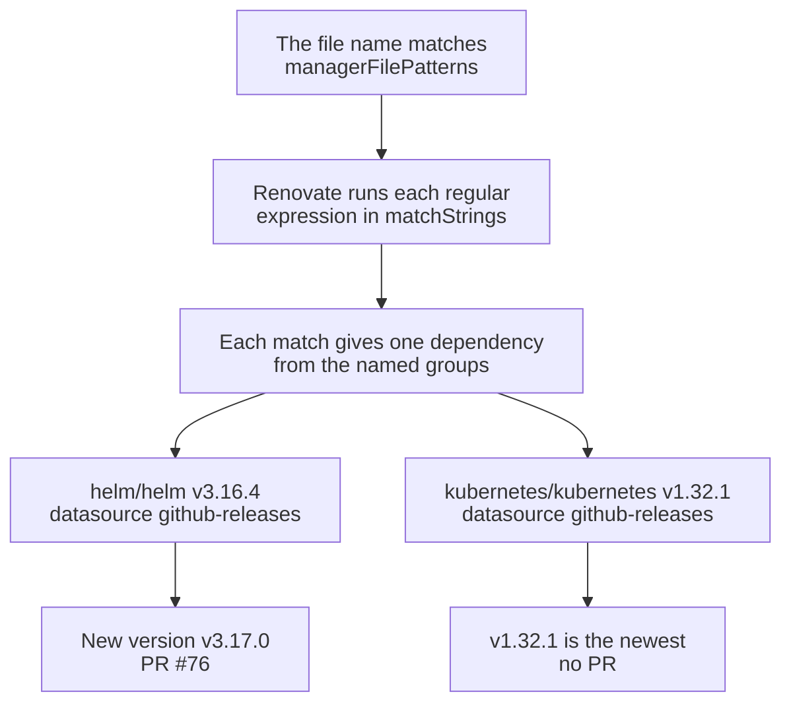

# 09.4: A custom regex manager for a company file

Some files have a format that only one company uses. No built-in manager reads them. A custom regex manager is a manager that you define in the configuration. It has a file pattern and a regular expression. The regular expression finds the dependency in the file. The example is `deploy/contoso-deploy.yaml`. It lists the versions of Helm and kubectl that the deploy job of Contoso installs.

| File | What it shows |
|---|---|
| [`renovate.json5`](renovate.json5) | The configuration: one custom regex manager |
| [`example-files/contoso-deploy.yaml`](example-files/contoso-deploy.yaml) | `deploy/contoso-deploy.yaml` before the PR |
| [`pull-requests/tool-helm.md`](pull-requests/tool-helm.md) | PR #76: `helm/helm` v3.16.4 to v3.17.0 |

## Built-in manager and custom regex manager

| | Built-in manager (parts 1, 2, 3 and 5) | Custom regex manager (this part) |
|---|---|---|
| Who writes it | The Renovate maintainers | You, in `customManagers` |
| How it reads the file | It parses the file format, for example YAML | It runs a regular expression on the text |
| File pattern | A default pattern, except `kubernetes` | Always your own `managerFilePatterns` |
| Datasource | Fixed by the manager | From the file or from `datasourceTemplate` |
| Lock files and Helm commands | Yes, for `helmv3` | No. Renovate only replaces the text of the version |

## How Renovate finds the dependency



## The regular expression

The file has a comment line above each version:

```yaml
  # renovate: datasource=github-releases depName=helm/helm
  helm: v3.16.4
```

The regular expression in [`renovate.json5`](renovate.json5) matches the two lines together:

```text
#\s*renovate:\s*datasource=(?<datasource>[a-z-]+)\s+depName=(?<depName>\S+)\s*\n\s*[\w-]+:\s*(?<currentValue>\S+)
```

In JSON5, each `\` is written as `\\`. Renovate adds the flag `g` to the regular expression. So it finds every match in the file, not only the first.

Each named group (a part of the regular expression with a name, `(?<name>...)`) fills one field of the dependency:

| Named group | Required | Use |
|---|---|---|
| `depName` | `depName` or `packageName` | The name in the PR title and the branch name |
| `packageName` | `depName` or `packageName` | The name at the datasource. Without it, Renovate uses `depName` |
| `currentValue` | `currentValue` or `currentDigest` | The version in the file. Renovate replaces this text |
| `currentDigest` | `currentValue` or `currentDigest` | A digest in the file |
| `datasource` | Yes | Where Renovate looks for new versions |
| `versioning` | No | The version scheme. Without it, Renovate uses `semver-coerced` |
| `registryUrl` | No | A registry. Without it, Renovate uses the default of the datasource |
| `extractVersion` | No | A regular expression that takes the version out of a tag |
| `depType` | No | A dependency type, for package rules |

Each group can also come from a template in the custom manager, for example `datasourceTemplate`.

If all files of one kind use the same datasource, leave the group out of the regular expression. Set `datasourceTemplate: 'github-releases'` in the custom manager instead.

## The comment convention

The comment `# renovate: datasource=... depName=...` is a convention, not a Renovate feature. The regular expression decides the format. Many teams use this format, because the Renovate docs show it. The comment keeps the datasource and the name next to the version. So one regular expression covers every tool in the file.

## Real behavior and illustration

These parts come from Renovate 44 and GitHub:

- The named groups, the `g` flag, and the field that each group fills.
- The PR title, the branch name, the table and the release notes, also the heading `vv3.17.0`.
- The release dates of Helm v3.17.0 and kubectl v1.32.1, and the release notes text.

The source files are `lib/modules/manager/custom/regex/index.ts`, `lib/modules/manager/custom/regex/utils.ts` and `lib/workers/repository/update/pr/changelog/release-notes.ts`. The file format, the repository and the check are fictional.

## Read more

- [Renovate docs: custom managers](https://docs.renovatebot.com/modules/manager/regex/)
- [Renovate docs: `customManagers`](https://docs.renovatebot.com/configuration-options/#custommanagers)
- [Renovate docs: github-releases datasource](https://docs.renovatebot.com/modules/datasource/github-releases/)
- [regex101: test a regular expression](https://regex101.com/)
