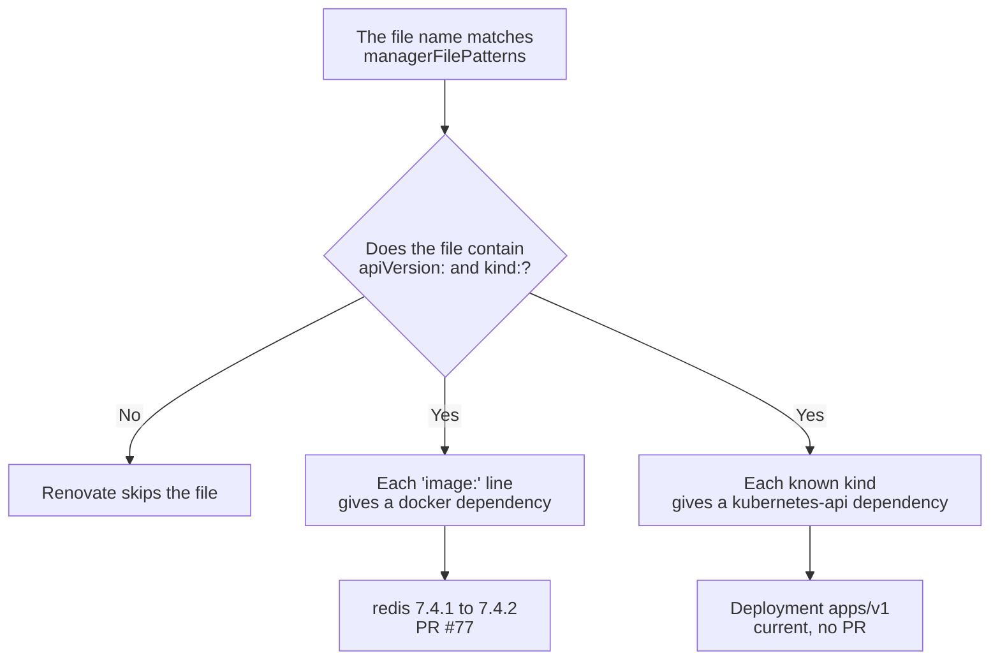

# 09.5: Kubernetes manifests

A Kubernetes manifest is a YAML file that describes a resource in a cluster, for example a Deployment. Teams that do not use Helm often keep plain manifests in the repository. The built-in manager `kubernetes` updates the container images in these files. The example is `k8s/redis.yaml`, with a Deployment and a Service for Redis.

| File | What it shows |
|---|---|
| [`renovate.json5`](renovate.json5) | The configuration: a file pattern for the `kubernetes` manager |
| [`example-files/redis.yaml`](example-files/redis.yaml) | `k8s/redis.yaml` before the PR |
| [`pull-requests/image-redis.md`](pull-requests/image-redis.md) | PR #77: `redis` 7.4.1 to 7.4.2 |

## The manager has no default file pattern

The other built-in managers in this feature find their files without configuration. The `kubernetes` manager does not, because a manifest has no fixed file name. Its default `managerFilePatterns` is an empty list. If you do not set a pattern, Renovate does not read any manifest.

```json5
kubernetes: {
  managerFilePatterns: ['/(^|/)k8s/.+\\.ya?ml$/'],
},
```

This pattern matches every `.yaml` and `.yml` file in a folder with the name `k8s`. Make the pattern as narrow as you can. A wide pattern such as `/\\.ya?ml$/` also matches `values.yaml`, workflow files and other YAML files.

## How Renovate finds the dependencies



The manager finds two kinds of dependencies:

| What | Where in the file | Datasource | Example |
|---|---|---|---|
| Container image | Each line `image: <name>:<tag>`, also in a list item | `docker` | `redis:7.4.1` |
| API version | `apiVersion` of a kind that has more than one API version | `kubernetes-api` | `Deployment` with `apps/v1` |

The image search reads the text line by line. It does not care where the line is. So it finds images in `containers`, `initContainers` and in a CronJob.

Kubernetes removes old API versions in new releases. The API version dependency finds a manifest that still uses one. For example, a Deployment with `extensions/v1beta1` gets a PR to `apps/v1`. The `Service` in the example has no entry in the list of the `kubernetes-api` datasource, so it gives no dependency.

## An image that moved

Old manifests often use images from `k8s.gcr.io`. That registry is frozen and gets no new images. The preset `replacements:k8s-registry-move` in `config:recommended` replaces the registry with `registry.k8s.io`. [Feature 06](../../06-replacement-prs/README.md) explains replacement PRs.

## Real behavior and illustration

These parts come from Renovate 44 and Docker Hub:

- The empty default file pattern and the check for `apiVersion:` and `kind:`.
- The image search, the list of kinds for `kubernetes-api`, and the result for `Deployment` and `Service`.
- The PR title, the branch name, the table and the release date of Redis 7.4.2.

The source files are `lib/modules/manager/kubernetes/extract.ts`, `lib/modules/manager/kubernetes/index.ts` and `lib/data/kubernetes-api.json5`. The PR number #77 and the check are fictional.

## Read more

- [Renovate docs: kubernetes manager](https://docs.renovatebot.com/modules/manager/kubernetes/)
- [Renovate docs: kubernetes-api datasource](https://docs.renovatebot.com/modules/datasource/kubernetes-api/)
- [Kubernetes docs: deprecated API migration guide](https://kubernetes.io/docs/reference/using-api/deprecation-guide/)
