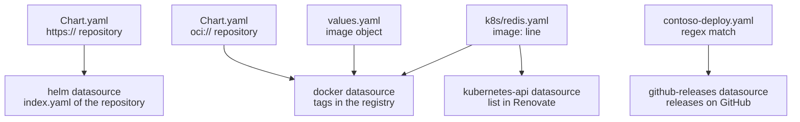

# 09: Helm and infrastructure

Renovate also updates the files that deploy an application, not only the files that build it. This feature shows five kinds of infrastructure files. Four use a built-in manager. One uses a custom regex manager. All five PRs come from one fictional repository, `contoso/contoso-platform`, on 2025-01-17.

| Part | What it shows | PR |
|---|---|---|
| [1. Helm chart dependencies](01-helm-chart-dependencies/README.md) | A public chart in `Chart.yaml`, with `Chart.lock` | [Update Helm release argo-cd to v7.7.16](01-helm-chart-dependencies/pull-requests/helm-argo-cd.md) |
| [2. Internal chart in an OCI registry](02-helm-oci-internal-chart/README.md) | An `oci://` chart in a private Azure Container Registry | [Update contoso-service Docker tag to v1.5.0](02-helm-oci-internal-chart/pull-requests/helm-contoso-service.md) |
| [3. Images in values.yaml](03-helm-values-images/README.md) | An image from a private registry in `values.yaml` | [Update contoso.azurecr.io/orders-api Docker tag to v1.8.0](03-helm-values-images/pull-requests/image-orders-api.md) |
| [4. Custom regex manager](04-custom-regex-manager/README.md) | Tool versions in a company deploy file | [Update dependency helm/helm to v3.17.0](04-custom-regex-manager/pull-requests/tool-helm.md) |
| [5. Kubernetes manifests](05-kubernetes-manifests/README.md) | An image in a plain Deployment | [Update redis Docker tag to v7.4.2](05-kubernetes-manifests/pull-requests/image-redis.md) |

## Built-in managers and the custom regex manager

A manager is the part of Renovate that reads one file format and finds the dependencies in it. A built-in manager comes with Renovate. A custom regex manager is one that you define in `customManagers`.

| Part | Manager | Kind | Files found by default | Datasource | How Renovate finds the dependency | `hostType` for a private registry |
|---|---|---|---|---|---|---|
| 1 | `helmv3` | Built-in | Every `Chart.yaml` | `helm` | `name`, `version` and an `https://` `repository` in `dependencies` | `helm` |
| 2 | `helmv3` | Built-in | Every `Chart.yaml` | `docker` | The same fields, with an `oci://` `repository` | `docker` |
| 3 | `helm-values` | Built-in | Every `values.yaml` | `docker` | An object under a key that ends in `image`, with `repository` and `tag` | `docker` |
| 4 | `regex` | Custom | None. You set `managerFilePatterns` | From the file | Named groups in your regular expression | Depends on the datasource |
| 5 | `kubernetes` | Built-in | None. You set `managerFilePatterns` | `docker` and `kubernetes-api` | Each `image:` line, and `apiVersion` with `kind` | `docker` |

Parts 1 and 2 use the same manager. The `repository` of the dependency decides the datasource, and the datasource decides the host type of the host rule.

## Where Renovate reads the new versions

## One configuration for all parts

Each part has its own `renovate.json5` with only the configuration for that part. [`configs/renovate.infrastructure.json5`](../../configs/renovate.infrastructure.json5) combines all five parts in one file that you can copy.

## Read more

- [Renovate docs: managers](https://docs.renovatebot.com/modules/manager/)
- [Renovate docs: helmv3 manager](https://docs.renovatebot.com/modules/manager/helmv3/)
- [Renovate docs: Docker](https://docs.renovatebot.com/docker/)
- [Renovate docs: custom managers](https://docs.renovatebot.com/modules/manager/regex/)
